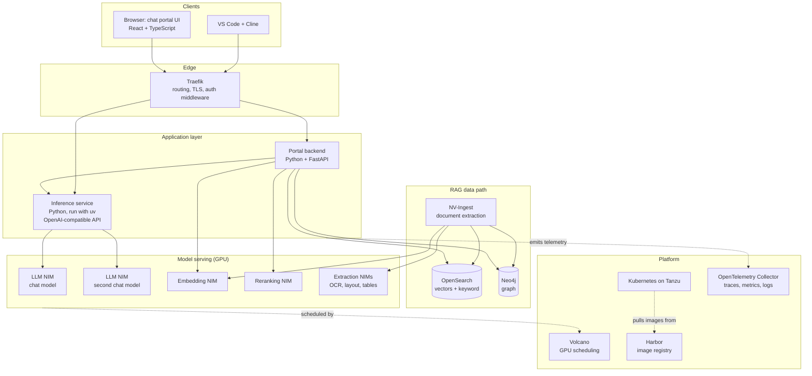

# The map

Read this first. It shows the whole system once, so that every later document
has somewhere to sit.

## The plain version

Think of a large private library with an expert sitting at the front desk.

- The **chat portal** is the front desk: where people walk up and ask.
- The **model** (served as a NIM) is the expert who answers. Experts are
  expensive and need special rooms, which are the **GPUs**.
- The **inference service** is the switchboard that connects any caller, the
  front desk or a developer's coding tool (**Cline**), to the right expert.
- **Traefik** is the building's reception: it checks who you are and sends you
  to the right room.
- **RAG** is letting the expert look things up before answering.
  **NV-Ingest** is the team that unpacks and files new documents;
  **OpenSearch** is the index that finds pages by meaning; **Neo4j** is the map
  of how people, projects and topics connect.
- **Volcano** is the room-booking system that decides which expert gets which
  room when there are not enough.
- **Harbor** is the loading dock: everything that enters the building comes
  through it, checked, because the building is not open to the street.
- **Kubernetes on Tanzu** is the building itself and its management.
- **OpenTelemetry** is the CCTV and logbook: how you find out where a request
  got slow or lost.
- A **Clio-style insights** layer is the librarian's monthly report on what
  kinds of questions people ask, written without recording who asked what.
- **Dev containers and Tilt** are the workshop where the staff build and test
  changes before they go into the building.

Every later document zooms into one of these and starts with its own plain
version.

## What the system is

A private chat-and-retrieval platform. Users talk to a chat portal in a
browser. The portal sends their messages to large language models that run on
the organisation's own GPUs. Later, the same platform answers questions over
the organisation's documents (retrieval-augmented generation, RAG) and gives
developers a coding assistant backed by the same models.

It grows in three stages. Knowing which stage a component belongs to tells you
how much of it is real today.

| Stage | What works | Components involved |
|---|---|---|
| 1. Chat | Portal talks to a model | Portal (React/TS + FastAPI), inference service, NIM, Traefik, Kubernetes, GPUs, Harbor |
| 2. Coding assistant | Cline in VS Code uses the same model | Inference service, Cline, dev containers |
| 3. RAG | Answers grounded in documents | NV-Ingest, embedding and reranking NIMs, OpenSearch, Neo4j, NeMo microservices, RAG Blueprint patterns |
| Alongside | Understanding what the portal is used for | Clio-style conversation insights |

## The picture

Solid arrows are requests. Dotted arrows are platform relationships.

## One chat request, hop by hop

1. **Browser.** The user types a message. The React app sends an HTTPS request
   to the portal's API and waits for a streamed reply.
2. **Traefik.** The request reaches the cluster's edge proxy. Traefik
   terminates TLS, matches the hostname and path to a route, applies
   middlewares (authentication, rate limits, headers) and forwards it to the
   portal backend's Kubernetes Service.
3. **Portal backend (FastAPI).** It checks who the user is, loads the
   conversation, builds the list of messages, and calls the inference service.
4. **Inference service.** It exposes an OpenAI-compatible API
   (`/v1/chat/completions`). It picks the model, forwards the request to the
   right NIM, and streams tokens back. Because the API is OpenAI-compatible,
   any client that speaks that protocol can use it, which is why Cline can.
5. **NIM.** A container holding a model and an optimised inference engine,
   running on one or more GPUs. It generates tokens and streams them back as
   server-sent events (SSE).
6. **Back up the chain.** Tokens flow NIM → inference service → portal backend
   → Traefik → browser, where React renders them as they arrive.
7. **Telemetry.** Each hop records a span. The spans share one trace ID, so a
   single slow request can be followed across every service.

## One RAG request: what stage 3 adds

Between steps 3 and 4 the portal backend first *retrieves*:

1. Turn the question into a vector by calling the **embedding NIM**.
2. Ask **OpenSearch** for the chunks whose vectors are nearest, usually
   combined with a keyword search (hybrid search).
3. Optionally ask **Neo4j** for entities and relationships connected to what
   was found, to answer questions that span several documents.
4. Pass the candidates to the **reranking NIM**, which orders them by
   relevance to the question.
5. Put the best chunks into the prompt, then continue with step 4 above.

Documents get into OpenSearch and Neo4j beforehand through **NV-Ingest**, which
splits files into text, tables and images using extraction NIMs, then embeds
and stores the pieces.

## What sits underneath

| Concern | Component | One-line job |
|---|---|---|
| Where it runs | Kubernetes on VMware Tanzu | Runs every container; Tanzu is how the clusters are created and managed on vSphere |
| Who gets a GPU | Volcano | Queues GPU workloads and decides which runs where, fairly and without deadlock |
| Where images come from | Harbor (built and moved with Podman) | Private registry; the cluster pulls from it rather than the internet |
| How you develop | Dev containers + Tilt | Same toolchain for everyone; code changes reach a dev cluster in seconds |
| How you see inside | OpenTelemetry | One standard for traces, metrics and logs from every service |
| What people use it for | Clio-style insights | Summarises and groups conversations into themes, without exposing individual chats |

## Reading order

Follow a request from the outside in, then go underneath:

1. [NVIDIA NIM](../prereading/01-nvidia-nim.md)
2. [Cline with a self-hosted model](../prereading/15-cline-with-a-self-hosted-model.md)
3. [uv, FastAPI and React primer](../prereading/16-uv-fastapi-react-primer.md)
4. [Traefik](../prereading/05-traefik.md)
5. [Dev containers](../prereading/13-dev-containers.md)
6. [Tilt](../prereading/14-tilt.md)
7. [Harbor, Podman and images](../prereading/12-harbor-podman-images.md)
8. [Tanzu Kubernetes](../prereading/10-vmware-tanzu-kubernetes.md)
9. [Volcano and GPU scheduling](../prereading/11-volcano-gpu-scheduling.md)
10. [OpenTelemetry](../prereading/07-opentelemetry.md)
11. [NVIDIA RAG Blueprint](../prereading/03-nvidia-rag-blueprint.md)
12. [NV-Ingest and extraction](../prereading/04-nv-ingest-extraction.md)
13. [OpenSearch and Elasticsearch vector search](../prereading/08-opensearch-elasticsearch-vector-search.md)
14. [Neo4j and graph retrieval](../prereading/09-neo4j-graph.md)
15. [NeMo microservices](../prereading/02-nemo-microservices.md)
16. [Clio-style conversation insights](../prereading/17-clio-conversation-insights.md)

The first ten cover stages 1 and 2, which are what exist today. Numbers 11 to 15
cover stage 3, and the last covers usage insights.

## Glossary

| Term | Meaning |
|---|---|
| NIM | NVIDIA Inference Microservice: a container packaging a model with an optimised inference server and a standard API |
| NeMo | NVIDIA's family of microservices around models: retrieval, guardrails, evaluation, customisation |
| RAG | Retrieval-augmented generation: fetch relevant text first, then have the model answer using it |
| Embedding | A list of numbers representing the meaning of a piece of text, so similar texts are close together |
| Reranker | A model that scores how well each retrieved chunk answers the question |
| SSE | Server-sent events: an HTTP response that stays open and delivers data in pieces; how tokens are streamed |
| OpenAI-compatible | Implements the same HTTP routes and JSON shapes as OpenAI's API, so standard clients work unchanged |
| Ingress / edge proxy | The component that receives traffic from outside the cluster and routes it to services |
| vcjob / PodGroup | Volcano's units for scheduling a set of pods together |
| OTLP | The OpenTelemetry wire protocol for sending telemetry |
| Dev container | A container that holds a project's whole development toolchain, described by `devcontainer.json` |
| Tiltfile | Tilt's configuration file describing how to build and deploy services during development |
